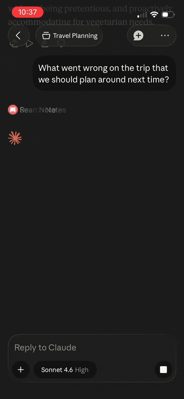
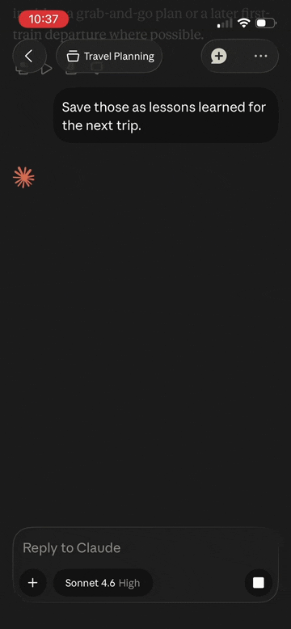

<!-- AUTO-GENERATED from README.md — do not edit manually. Run: npm run generate:dockerhub-readme -->

  

> **Full documentation:** [github.com/aliasunder/vault-cortex](https://github.com/aliasunder/vault-cortex)
>
> This is an abbreviated version for Docker Hub. See the full README for quick-start guides, authentication details, and development instructions.

**Vault Cortex** is a standalone MCP server that gives any AI agent **hybrid search, task management, structured memory, and read/write access** to your [Obsidian](https://obsidian.md) vault, from your laptop or your phone. No plugins, no running Obsidian, no separate bridge. One Docker container, your vault folder, a full tool suite + guided prompts. Run it on a remote server with Obsidian Sync, and the same vault is accessible from your phone, claude.ai, or any remote MCP client, secured with OAuth 2.1. Deploy it with one click or self-host it; either way, the vault is always yours.

## What you get

<table align="center">
  <tr>
    <td align="center"><strong>Search the vault</strong></td>
    <td align="center"><strong>Reason over notes</strong></td>
    <td align="center"><strong>Write back to Obsidian</strong></td>
  </tr>
  <tr>
    <td></td>
    <td></td>
    <td></td>
  </tr>
</table>

<em>All three demos run on Claude mobile. The vault is on a remote server, not the phone.</em>

**Tested across a 15-day trip through Europe.** 30+ sessions from a phone, 216 tool calls, zero laptop access needed. Writes in one session were immediately available in the next, across cities and days.

- **[Remote access](https://github.com/aliasunder/vault-cortex#remote-access-from-anywhere)** — works from your phone, a remote server, or any MCP client via OAuth 2.1. One click on Render or Railway gets you there with no server to manage; a VPS works too.
- **[Structured memory](https://github.com/aliasunder/vault-cortex#memory)** — dated, append-only entries accumulate into a personal knowledge layer, auto-initialized for AI personalization. Topic recall answers "what do I think about X?" with the current take and the dated history behind it — evolution included.
- **[Tasks](https://github.com/aliasunder/vault-cortex#tasks)** — Kanban-aware task queries and updates: triage by status, dates, or priority, then complete, reprioritize, or move tasks between lanes in one call. Completing a recurring task spawns its next occurrence. Parses both [Tasks plugin](https://publish.obsidian.md/tasks/) emoji and [Dataview](https://blacksmithgu.github.io/obsidian-dataview/) inline-field formats.
- **[Hybrid search](https://github.com/aliasunder/vault-cortex#hybrid-search)** — FTS5 keyword matching + vector semantic similarity via RRF fusion, refined by cross-encoder reranking for intent-heavy queries. Keywords stay precise on exact terms and jargon; vectors find notes even when your words differ from the vault's.
- **[Files](https://github.com/aliasunder/vault-cortex#files)** — read the vault's non-markdown files too: images arrive as actual images (shrunk to fit when needed), PDFs as structured text or rendered pages, canvases as readable outlines, data files, HTML pages, and scripts as text. Canvases, Bases, and other text files can be written back, and any non-markdown file can be deleted
- **[Obsidian-native](https://github.com/aliasunder/vault-cortex#properties)** — understands frontmatter, wikilinks, tags, headings, and [daily notes](https://github.com/aliasunder/vault-cortex#daily-notes)
  - **[Link graph](https://github.com/aliasunder/vault-cortex#tools)** — backlinks, outgoing links, and orphan detection across the vault
- **[Plugin-free](https://github.com/aliasunder/vault-cortex#how-it-works)** — Obsidian doesn't need to be running. The server works directly with `.md` files on disk. Headless sync keeps the vault current.
- **[Guided workflows](https://github.com/aliasunder/vault-cortex#prompts)** — built-in prompts for vault health, memory review, and daily reconciliation — assembled from live vault data each time

---

## Quick Start

See the [full Quick Start guide](https://github.com/aliasunder/vault-cortex#quick-start) for local setup (2 minutes with Docker), one-click hosting on Render or Railway, remote deployment with Obsidian Sync, and MCP client configuration.

## Tools

Reads and edits can work on part of a note, so a long note doesn't fill the agent's context window. `vault_read_note` can return just a note's properties, its heading outline, one section, or a window of lines. `vault_replace_span` and `vault_delete_span` find a block by a short fragment of its first and last lines, and `vault_insert_at_anchor` places new lines beside a line found the same way, so the agent edits a block without reproducing it.

| Category | Tool | Description |
| --------------- | ---------------------------- | ---------------------------------------------------------------------------------------------------------------------------- |
| **Vault CRUD** | `vault_read_note` | Read a note — full body, properties, outline, or a section |
|  | `vault_write_note` | Create a note (fails if it already exists; set `overwrite` to replace) |
|  | `vault_patch_note` | Heading-targeted edit (append, prepend, replace with `include_children` guard, insert) |
|  | `vault_replace_in_note` | Find-and-replace text in a note (first match or `replace_all_occurrences`) |
|  | `vault_delete_span` | Delete a block of lines by short anchors, no full re-quote |
|  | `vault_replace_span` | Replace a block of lines by short anchors with new content |
|  | `vault_insert_at_anchor` | Insert content before or after a line identified by a short anchor |
|  | `vault_list_notes` | List notes with optional glob/folder filter |
|  | `vault_delete_note` | Delete a note — trashed per Obsidian's "Deleted files" setting, permanent under Sync (protected paths enforced) |
|  | `vault_move_note` | Move or rename a note, rewriting links across the vault |
| **Search** | `vault_search` | Hybrid search with tag/folder/property/date filters |
|  | `vault_search_by_tag` | Find notes by tag, including the tags nested under it |
|  | `vault_search_by_folder` | Browse notes in a folder with metadata |
|  | `vault_recent_notes` | Recently modified or created notes |
|  | `vault_list_tags` | All tags with usage counts |
| **Tasks** | `vault_list_tasks` | Vault-wide task index with sub-task depth — Kanban-aware, date/priority/heading filters |
|  | `vault_create_task` | Create a correctly-formatted task — dates, priority, recurrence, on_completion, sub-tasks, block_id |
|  | `vault_update_task` | Edit any task field in one call — completing a recurring task creates its next occurrence |
| **Memory** | `vault_get_memory` | Read structured memory (file, section, or all) |
|  | `vault_update_memory` | Append a dated entry to a memory section |
|  | `vault_delete_memory` | Remove a specific memory entry by date |
|  | `vault_list_memory_files` | Discover memory files, their sections, and each file's entry policy |
|  | `vault_memory_recall` | Entry-granular hybrid recall of a topic across memory files, oldest-first |
| **Properties** | `vault_list_property_keys` | All property keys with sample values |
|  | `vault_list_property_values` | Distinct values for a property key |
|  | `vault_search_by_property` | Find notes by property key-value |
|  | `vault_update_properties` | Add, update, or replace properties without touching the body |
| **Links** | `vault_get_backlinks` | Notes linking to a given path |
|  | `vault_get_outgoing_links` | Links from a given note |
|  | `vault_find_orphans` | Notes with no incoming links |
| **Files** | `vault_read_file` | Read a non-markdown file — images delivered as images, canvases as readable outlines |
|  | `vault_write_file` | Create or replace a canvas, Base, or other text file, checked for valid JSON or YAML first |
|  | `vault_delete_file` | Delete a non-markdown file — trashed per Obsidian's "Deleted files" setting, permanent under Sync (protected paths enforced) |
|  | `vault_list_files` | Browse the vault's non-markdown files with sizes and per-extension counts |
| **Daily Notes** | `vault_get_daily_note` | Today's (or any date's) daily note |

---

## Prompts

Tools are model-driven — the assistant calls them. **Prompts** are workflows _you_ trigger. Each one queries the search index, link graph, and memory layer at invocation time, then assembles the results with guided instructions — so the session starts grounded in your vault's actual state, not assumptions.

| Prompt | Arguments | What it does |
| ------------------- | --------------------- | ----------------------------------------------------------------------------------------------------------------------------------------------------------------------------------------------------------------------------------------------------------------------------------------------------------- |
| `vault-orientation` | — | Surveys vault stats, folder distribution, property adoption rates (flags low adoption), orphans, broken link count, tags, recent notes, and the memory layer — with contextual tool suggestions |
| `memory-review` | `file?`, `max_chars?` | Structural overview (scope callouts, section entry counts) + dated content as a timeline. Guided reflection: how entries changed over time, entries in the wrong file, facts not yet recorded, and topics not yet covered — append-only by default, pruning proposed only for `entry-policy: living` files. |
| `daily-review` | `date?`, `max_chars?` | Reconciles a day — daily note, vault-wide task status (due/overdue, scheduled), modified notes, outgoing links (broken-link detection), and backlinks — surfaces what happened, what's open, and what needs follow-up |

`memory-review` is hidden when `MEMORY_ENABLED=false`, `READONLY_MODE=true` or `DISABLED_TOOLS` includes `vault_update_memory`.

Prompts adapt to your configuration (`MEMORY_DIR`, daily-notes settings) and work for any vault out of the box. Pass `max_chars` to cap embedded content if your client has payload limits.

> **Client support:** Prompts work in Claude Desktop (Chat and Cowork — via the **+** menu under your connector), Claude Code (slash commands), and OpenCode. Support in other clients (Cursor, Windsurf) varies — see the [MCP clients matrix](https://modelcontextprotocol.io/clients) for the latest.

---

## Properties

Vault Cortex indexes every [property](https://help.obsidian.md/Editing+and+formatting/Properties) in your notes, but five get **promoted** treatment — dedicated columns for fast filtering, and top-level fields in every search and discovery result:

| Property | What you can do |
| --------- | ------------------------------------------------------------------------------------------------------------ |
| `title` | Display name in search results; falls back to the filename when missing |
| `tags` | Search and filter by tag, in the property or written as `#tag` in a note (`project` matches `project/a`) |
| `type` | Filter by note type — `meeting`, `person`, `session-log`, or any value your vault uses |
| `created` | Sort by creation date and see when each note was created alongside every search result |
| `related` | Filter for notes that cross-reference a specific link — surfaces connections invisible without a graph query |

## Configuration

All settings are environment variables with sensible defaults, set in `.env` or in the service's **Variables** tab on Railway and **Environment** tab on Render. The table lists the required settings and the switches most installs change; every setting, with its default and limits, is in the [local](https://github.com/aliasunder/vault-cortex/tree/main/deploy/local/README.md#configuration) and [remote](https://github.com/aliasunder/vault-cortex/tree/main/deploy/remote/README.md#configuration) guides' configuration tables, which also cover Obsidian Sync's own settings.

| Variable | Required for | Default | Description |
| ---------------------- | ------------ | ---------------------------------------------------- | ------------------------------------------------------------------------------------------------------------------------------------------------------------------------------------------------------------------------------------------------------- |
| `MCP_AUTH_TOKEN` | All | — | Bearer token for authentication (also the JWT signing key) |
| `VAULT_PATH` | Local | — | Host path to your vault. Must not contain `*`, `?`, or `[` — rejected at startup. |
| `PUBLIC_URL` | Remote | — | Public URL clients connect to, used for OAuth discovery. Filled in automatically on Render and Railway when left unset |
| `VAULT_NAME` | Remote | — | Exact name of your Obsidian vault (case-sensitive) |
| `EMBEDDING_ENABLED` | — | `true` | Set `false` for keyword-only search: no model download, no vector index, no hybrid search. |
| `RERANK_MODE` | — | `blended` | `blended` reranks results with the cross-encoder (~200ms added latency); `none` skips reranking. Only takes effect when `EMBEDDING_ENABLED` is true. |
| `MEMORY_ENABLED` | — | `true` | Set `false` to hide the memory tools and skip creating the memory folder. |
| `FILE_TOOLS_ENABLED` | — | `true` | Set `false` to hide the file tools. To keep reading files but turn off writing and deleting them, set `DISABLED_TOOLS=vault_write_file,vault_delete_file` instead. |
| `READONLY_MODE` | — | `false` | Set `true` to hide every tool that changes the vault and skip memory folder auto-creation — connected clients can read and search but never edit. |
| `DISABLED_TOOLS` | — | — | Hide individual tools by name, comma-separated (e.g. `vault_delete_note,vault_move_note`); names match the Tool column in the [tools table](https://github.com/aliasunder/vault-cortex#tools). It cannot re-enable a tool another setting hides, and an unknown name stops the server at startup. |
| `PROTECTED_PATHS` | — | the memory folder (`MEMORY_DIR`), daily notes folder | Comma-separated folders whose notes and files can't be deleted, whose notes can't be moved, and that no note can be moved into; their notes stay editable. A value you set replaces both default folders. |
| `TZ` | — | `UTC` | IANA timezone for timestamps and daily note resolution |
| `TRASH_RETENTION_DAYS` | — | `30` | Days a note or file deleted under Obsidian's default "Move to system trash" setting stays in `.trash/` before the server cleans it up; `none` keeps them forever. Unused with Obsidian Sync, whose deletes are permanent. |

## Deployment Options

Local runs on your machine. Remote deployments run on a VPS or a hosted container platform — your vault is accessible even when your laptop is closed.

Whichever path you pick, the server is replaceable and your vault isn't. Your notes are plain Markdown files, synced by Obsidian to every device you own; the container holds a copy and an index it can rebuild from scratch. Shut down the VPS, delete the Render or Railway service, switch hosts — the same files are still on your machine and in Obsidian Sync, readable by anything. That's the difference from an AI notebook whose real home is the vendor's database: here the host is a convenience, not a custodian.

| Path | What | Guide |
| ------------------------ | ------------------------------------------------------------------------------------------------------------------------------------------------------------------- | ----------------------------------------------------------------------------- |
| **Local** | Your vault on your machine — free, no cloud | [`deploy/local/`](https://github.com/aliasunder/vault-cortex/tree/main/deploy/local/) |
| **Remote · one-click** | Render or Railway — one persistent volume, no server to manage; Render deploys from the [`render.yaml`](https://github.com/aliasunder/vault-cortex/blob/main/render.yaml) Blueprint, Railway from a published template | [`deploy/render/`](https://github.com/aliasunder/vault-cortex/tree/main/deploy/render/) · [`deploy/railway/`](https://github.com/aliasunder/vault-cortex/tree/main/deploy/railway/) |
| **Remote · self-hosted** | VPS + Obsidian Sync — access from any device | [`deploy/remote/`](https://github.com/aliasunder/vault-cortex/tree/main/deploy/remote/) |
| **Remote · AWS (SST)** | IaC reference deployment — automated infra, defense-in-depth auth, [~$17–29 USD/mo all-in](https://github.com/aliasunder/vault-cortex/blob/main/ARCHITECTURE.md#cost) | [`DEPLOY.md`](https://github.com/aliasunder/vault-cortex/blob/main/DEPLOY.md) |

## Versioning

[VERSIONING.md](https://github.com/aliasunder/vault-cortex/blob/main/VERSIONING.md) says which changes count as breaking, how
they are announced, and how the server and CLI versions relate.

---

## License

[MIT](https://github.com/aliasunder/vault-cortex/blob/main/LICENSE) — see the full [License section](https://github.com/aliasunder/vault-cortex#license) for details on bundled components.
